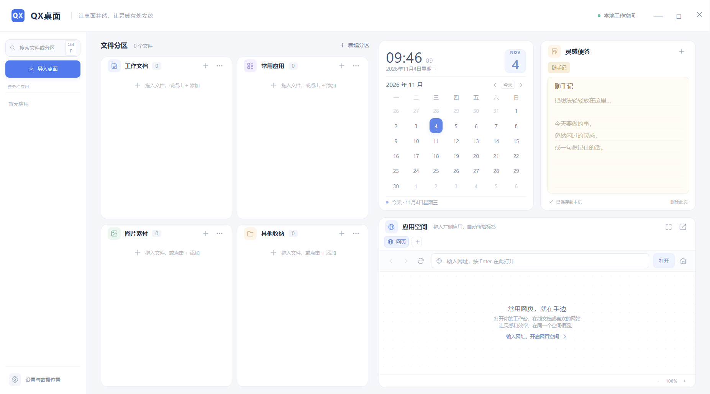

# QX桌面


> **特别说明：本软件由 AI 开发。**
>
> QX桌面的产品构思、代码实现、界面样式与本文档均由 AI（Qoder / 大语言模型）生成，经人工实际运行、测试与发布。软件按现状提供，使用前请先阅读文末的「已知限制」。

一个面向 Windows 10 / 11 的**便携式桌面整理工具**：把散落的桌面文件、常用应用、网页和便签收进同一个窗口，临时接管桌面图标与任务栏应用图标，关闭后完整恢复原样。

当前版本：**1.0.20**（便携版，无需安装）



---

## 设计理念

| 原则 | 说明 |
| --- | --- |
| 一个窗口完成工作 | 文件、日历、便签、网页和常用应用在同一屏内，不用来回切换窗口 |
| 本机优先 | 分区、文件入口和便签都保存在本机，不上传云端，不需要账号 |
| 可逆的接管 | 桌面图标和任务栏只是「临时隐藏」，退出 QX 立即还原，不改动原文件、不修改固定应用 |
| 尊重原有习惯 | 文件保留在原位置，QX 只保存入口；双击仍用系统默认程序打开 |
| 少打扰 | 无广告、无后台常驻，关闭即退出 |

---

## 界面一览

主界面分为四个区域：

```
┌────────────┬───────────────────────────┬──────────────────┐
│            │  文件分区（多分区卡片）     │  日历             │
│  左侧应用栏 │  拖入文件 / 新建分区        ├──────────────────┤
│  （Dock）   │                           │  灵感便签          │
│            │                           ├──────────────────┤
│            │                           │  应用空间（标签页） │
└────────────┴───────────────────────────┴──────────────────┘
```

- **左侧应用栏**：列出任务栏上的常用应用，点击启动或切换窗口；拖到「应用空间」可作为标签内嵌。
- **文件分区**：默认提供「工作文档」「常用应用」「图片素材」「其他收纳」四个分区，可重命名、新建、删除（默认分区不可删除）。
- **日历**：显示当前时间、月历，可切换月份、回到今天。
- **灵感便签**：多页便签，输入即自动保存到本机。
- **应用空间**：内嵌网页和 Windows 原生应用，支持多标签、展开和缩放。

---

## 使用指南

### 1. 启动

1. 下载 `release/QX桌面.exe`。
2. 双击运行，无需安装；首次启动会自动导入桌面上的文件入口。
3. 关闭窗口即退出程序，桌面图标和任务栏恢复原状。

> 提示：便携版每次运行会解压到临时目录。升级后请使用新版 EXE，避免旧临时目录中的组件残留。

### 2. 文件分区

| 操作 | 方式 |
| --- | --- |
| 导入桌面文件 | 点击左侧「导入桌面」，或把文件/文件夹直接拖到分区卡片 |
| 添加单个文件/文件夹 | 分区标题栏的 `+` |
| 打开 | 双击，或选中后按 `Enter` |
| 移动到其他分区 | 把文件条目拖到另一个分区，或右键 →「移动到分区」 |
| 打开所在位置 | 右键文件 →「打开所在位置」 |
| 移除入口 | 右键 →「移除入口」，或选中后按 `Delete` |
| 新建分区 | 文件分区标题右侧的「+ 新建分区」 |
| 重命名/删除分区 | 分区标题栏的「…」菜单（默认分区只能重命名） |

说明：

- 只保存文件**路径**，不会移动或复制原文件。
- 被移除的入口会被记住，下次启动不会自动重新导入；需要时手动添加即可恢复。
- 源文件被移动或删除后，双击会提示重新添加。

### 3. 搜索

按 `Ctrl + F` 聚焦左上角搜索框，可按文件名或分区名过滤。

### 4. 日历与便签

- 日历支持上月 / 下月 / 回到今天。
- 便签自动保存，可新建多页、切换、删除；内容保存在本机数据目录。

### 5. 网页空间

1. 在「应用空间」地址栏输入网址，按 `Enter` 打开。
2. 支持后退、前进、刷新、在系统浏览器中打开、关闭网页返回起始页。
3. 点击右上角展开按钮可放大应用空间，按 `Esc` 还原。
4. 可调整网页缩放（`Ctrl + +` / `Ctrl + -` / `Ctrl + 0`）。

限制：仅支持 `http://` / `https://` 网页；网页中如带账号密码的地址会被拒绝。

### 6. 将应用内嵌到应用空间

1. 从左侧应用栏把应用**拖到右下角的应用空间**（或点击标签栏 `+` 选择）。
2. 应用窗口会变成应用空间中的一个标签，随 QX 窗口移动、缩放。
3. 关闭标签即可把应用窗口原样还回桌面。
4. 左栏图标上：
   - 单击：启动应用或切回窗口；
   - 多窗口应用：弹窗选择具体窗口；
   - 右键：最大化 / 最小化 / 关闭窗口。

注意：少数使用特殊渲染方式的应用可能无法内嵌，QX 会提示原因并保留原窗口，不会影响应用本身。

### 7. 任务栏与桌面接管

在支持的 Windows 环境中启动并准备好后，QX 会：

- 把桌面图标临时隐藏，QX 运行时桌面保持干净；
- 把任务栏上的应用图标收进左侧应用栏，仅隐藏应用按钮，**保留开始菜单、搜索、托盘和时钟**；
- 最小化时任务栏只保留 QX 自己。

退出 QX 时会**全部恢复**：桌面图标、任务栏按钮、被内嵌应用的窗口样式和位置。整个过程不修改固定应用和任务栏设置。

### 8. 设置


点击左下角「设置与数据位置」：

- **数据保存位置**：查看或更改数据目录；切换时复制现有数据，并保留原目录副本。
- **任务栏应用**：显示当前接管状态。
- **开机自启动**：登录 Windows 后自动打开 QX。
- **使用与备份**：关闭 QX 后可直接复制数据目录做备份。

---

## 快捷键

| 快捷键 | 功能 |
| --- | --- |
| `Ctrl + F` | 聚焦文件搜索 |
| `Ctrl + L` | 聚焦网页地址栏（网页标签下） |
| `Ctrl + +` / `Ctrl + -` / `Ctrl + 0` | 网页放大 / 缩小 / 恢复 100% |
| `Esc` | 还原展开的应用空间 / 关闭菜单 |
| `Enter` | 打开选中的文件 |
| `Delete` | 移除选中的文件入口 |
| `Shift + F10` / 菜单键 | 打开应用窗口菜单 |

---

## 数据与隐私

- 分区、文件入口、便签保存在本机数据目录，可随时打包备份。
- 不收集、不上传任何使用数据。
- 网页登录信息保存在系统应用目录，不会写入工作区数据；更换数据目录不会迁移网页登录状态。
- 原桌面文件不会被移动、重命名或删除。

---

## 已知限制

- 仅支持 Windows 10 / 11 x64。
- 应用内嵌依赖 Windows 原生窗口接口，UWP 应用或使用特殊浮层渲染的应用可能无法内嵌（如部分版本的微信），此时会保留原窗口并提示。
- 内嵌时若应用自身限制最小尺寸，超出应用空间的部分会被裁剪，不会覆盖窗口其他区域或任务栏。
- 任务栏接管只隐藏应用图标，不隐藏开始、搜索、托盘和时钟。
- 开机自启动以当前 EXE 路径为准；移动便携版文件后需重新在设置中开启。

---

## 技术架构

```
Electron 主进程 (src/main.cjs)
 ├── 渲染界面 (src/index.html / renderer.js / styles.css)
 ├── 网页视图 WebContentsView
 ├── 数据存储（本地工作区目录）
 └── 原生桥接 QXDesktopBridge.exe（C#，.NET Framework）
      ├── icons：提取文件/快捷方式图标
      ├── guard <pid>：隐藏桌面图标、内嵌窗口管理、退出恢复
      ├── dock <pid>：读取任务栏应用与窗口清单
      └── desktop-state：桌面接管状态
```

- 主进程通过 IPC 暴露受限接口，渲染进程启用 `contextIsolation`、`sandbox`，禁止 Node 直接访问。
- 原生桥接只接受应用清单中存在的 ID，拒绝任意路径或窗口句柄，避免被网页内容利用。
- 应用清单每 1.5 秒刷新；组件异常时自动重启并退避重试，单次失败不会永久停用左侧应用栏。

---

## 本地开发

```bash
# 安装依赖
npm install

# 开发运行（会先编译原生组件）
npm start

# 单元测试
npm test

# UI 集成测试
npm run test:ui

# 打包便携版到 release/
npm run build
```

环境：Node.js 24、Electron 45、electron-builder 26、Playwright 1.64；原生组件由 `csc.exe` 编译 `src/native/*.cs`。

---

## 关于 AI 开发

- 本项目的代码、界面设计、测试用例和本文档**主要由 AI 生成**，人类负责提出需求、验收效果与发布版本。
- AI 生成的代码已通过单元测试（150 项）和 UI 集成测试（78 项），但仍可能存在未知缺陷。
- 涉及系统任务栏、桌面图标和窗口样式的操作均按「可逆」原则实现，但建议在重要工作中先保存文件，再运行本程序。
- 软件不提供任何明示或暗示的担保，使用风险由使用者自行承担。


